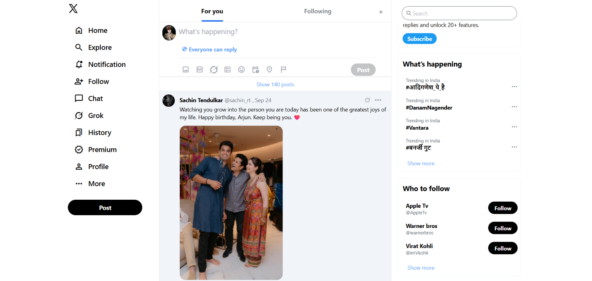

# Twitter (X) Clone

A responsive Twitter/X clone built with HTML and Tailwind CSS.

## Screenshots

## Features
- Three-column layout (sidebar, feed, trends)
- Responsive design for mobile and desktop
- Styled with Tailwind CSS

## Built with
- HTML
- Tailwind CSS (CLI)

## Run it locally
1. Clone the repo:
   `git clone https://github.com/krishvermaxd-spec/twitter-clone.git`
2. Install dependencies:
   `npm install`
3. Build the CSS:
   `npx tailwindcss -i ./src/input.css -o ./src/output.css --watch`
4. Open `index.html` in your browser.

## Author
Krish